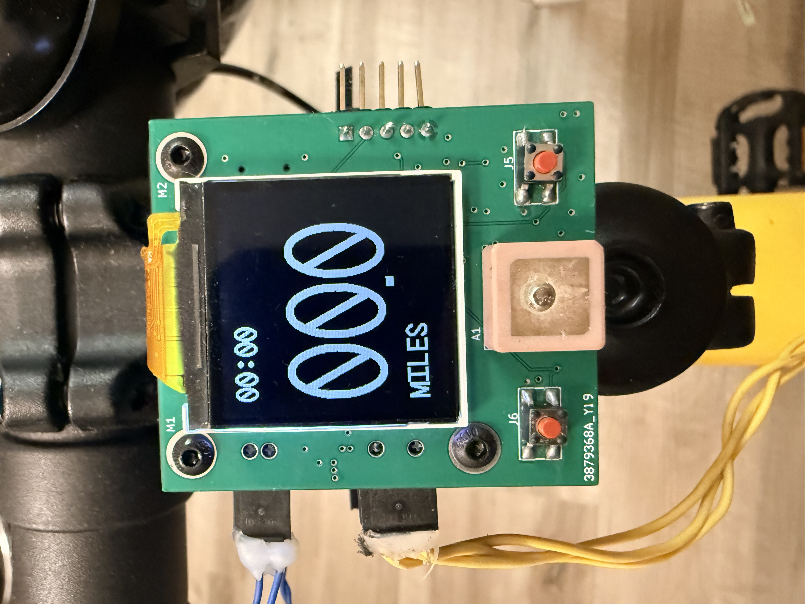
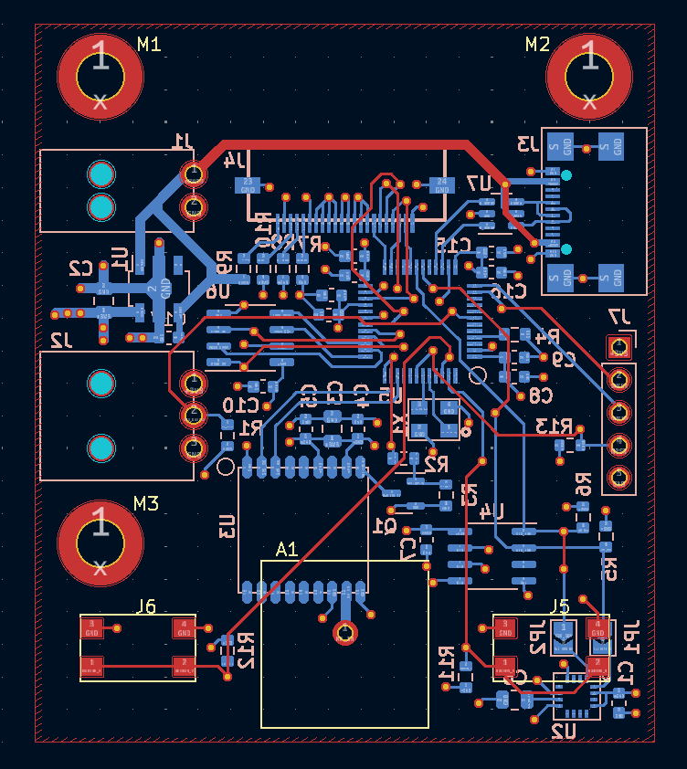

## About

The Shrew is a very basic GPS capable bike computer, built around a STM32G491CET6 microcontroller as the main processor. This project can be used as a standalone minimalist bike computer, or a reference design for any of the chips/firmware combos used in this design.

***NOTE:*** The PCB and firmware are currently operational, but this repo and documentation are currently still under construction.

Features and Highlights Include:
- STM32G491CET6 microcontroller as the main processor
- 240x240 1.54" full color display (only black and white used in this project though)
    - Adafruit Product ID: 4421
- Simple 2 button user interface
- GPS positioning and coordinate logging to a 2 Mbit FRAM
- USB-C interface for readout of logged GPS coordinates and power input
- Ambient temperature sensor
- Bike wheel rotation sensing via external hall-effect sensor

While in use, the display can provide the user with plenty of useful data, including:
- Total session distance
- Total session time
- current speed
- GPS coordinates
- current GPS satellite time
- current heading (calculated from current and previous GPS coordinates)
- ambient temperature

All hardware and firmware design files for The Shrew bike computer are included in this repo.

## Repo Structure
The repo is divided in to hardware and firmware folders. Explanations of each are given below

### Hardware

The hardware side of things is pretty straightforward. The hardware folder contains all the files needed for the single KiCad project that was used to design the PCB. The KiCad project structure for the project file, schematic file, and pcb file have all been left intact. So opening the project file in KiCad should open the project normally with all the schematic symbols and layout footprints referencing the included libraries in the `componentLibrary\` folder. 

### Firmware
The firmware directory is a little more interesting. The STM32CubeIDE with CubeMX code configuration was the main development environment used to develop the firmware for this project. This repo does ***NOT*** contain all the project files necessary for the STM32CubeIDE project for this design. This repo contains ***ONLY*** the custom .c and .h files that will need to be imported into the project generated by STM32CubeIDE. 

Any potential users of this repo will need to independently:
- install STM32CubeIDE
- create a new project for the STM32G491CET6 microcontroller
- import the `theShrewBikeComputer.ioc` configuration file
- generate the initialization code
- import the .c and .h files from this repo into the project
- call the `bikeComputerInit()` function in `main.c` between the `/* USER CODE BEGIN 2 */` and `/* USER CODE BEGIN 2 */` tags
- call the `bikeCOmputerMainLoop()` function in `main.c` directly after `while (1) {` withing the `/* USER CODE BEGIN WHILE */`

More detailed instructions on how to initialize the project should hopefully be added soon. While this structure may not be the most user friendly, it does have its benefits!!! Namely, less dependence on STM32CubeIDE version, easier licensing, and less complicated, more maintainable repo structure. 

## Licensing

This repository contains hardware and firmware components
that are licensed separately.

### Hardware

All original hardware design files in the `hardware/`
directory are licensed under the CERN Open Hardware
License Version 2 - Weakly Reciprocal (CERN-OHL-W-2.0).

### Firmware

All original firmware source code in the `firmware/`
directory is licensed under the Mozilla Public License
2.0 (MPL-2.0).

### Third-party components

Third-party components retain their respective original
licenses. See their accompanying license notices where
applicable.